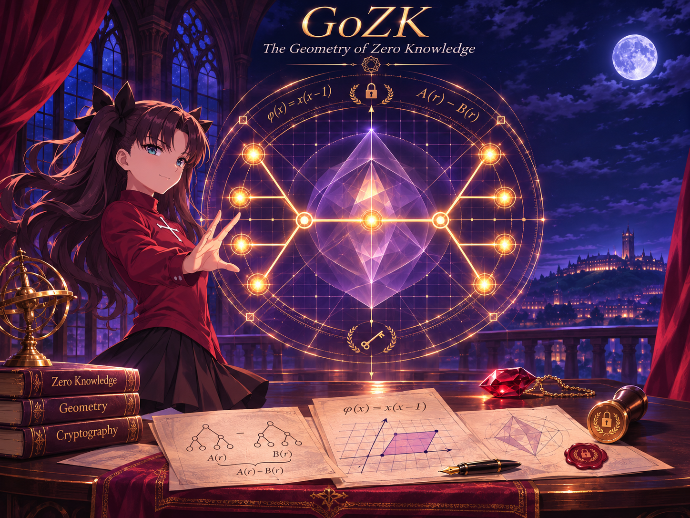

# GoZK

Rust implementation of *The Geometry of Zero Knowledge: Tight Masking and Efficient Multilinear Arguments*. GoZK uses the verifier's joint observations to choose a masking space. For two product trees, the verifier sees four boundary values from each tree and one difference between their roots. Nine random field coefficients mask exactly these nine observations.

The prover combines the gate, copy, and public-input checks in one global sumcheck. A causal helper masks the round messages, and a pairing-based polynomial commitment scheme authenticates the terminal evaluations over BLS12-381.

## Build and test

The repository pins Rust 1.85.1 and the arkworks dependencies. From the repository root, run:

```sh
cargo build --release --locked
cargo test --release --locked --features parallel
```

## Generate and verify a proof

This example sets up a two-row, eight-column instance of the thirteen-selector gate. The second command loads the public SRS, certifies the index, generates a proof, and verifies it in both individual and aggregate modes.

```sh
mkdir example-output
cargo run --release --locked --bin hp7 -- setup example-output/core.srs 1 3 1 5 true 3
cargo run --release --locked --bin hp7 -- fixture example-output/core.srs fixed13 example-output/proof.json
```

The setup arguments after the output path are the row and column logarithms, public-slice logarithm, gate degree, tight-cap flag, and column anchor. Use fresh output filenames on a second run. The JSON fixture includes the serialized proof, public input, and observations from both verifiers.

## Code map

| Component | Entry points |
| --- | --- |
| Source masks and global sumcheck | [Protocol](src/protocol.rs), [native relations](src/native.rs), [degree profiles](src/profile.rs) |
| Index, commitments, and openings | [Public index](src/index.rs), [pairing backend](src/pcs.rs) |
| Lookup and controlled comparisons | [Scalar lookup](src/lookup.rs), [arbitrary-point masks](src/general_mask.rs), [native sumchecks](src/multi.rs), [trace baseline](src/trace_protocol.rs) |
| Execution and verification | [Example driver](src/bin/hp7.rs), [Linux benchmark driver](src/bin/hp8.rs), [integration tests](tests/) |

## Measured results

On matched eight-column instances at 2¹⁰, 2¹⁴, and 2¹⁶ witness cells, query-aware masking used 19 source coefficients versus 390 for the implemented arbitrary-point control. Each proof was 4,128 bytes smaller. The median paired prover-time ratios (control / GoZK) were 1.674, 1.400, and 1.481 on four Xeon Gold 6230 cores. With the masks fixed, one global sumcheck saved 6,752–10,400 bytes versus seven native checks. The native checks were faster at the two larger sizes.

## Open work

The paper and implementation are still in development. One open task is an end-to-end comparison with the original HyperPlonk implementation on matched circuits and hardware. If you would like to help design that experiment or develop GoZK with us, please contact [728800377@qq.com](mailto:728800377@qq.com).
